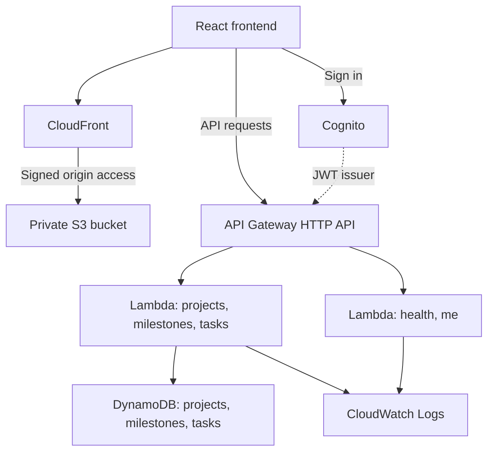
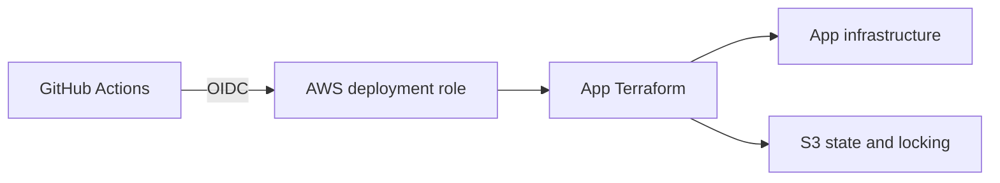

# AWS Task Manager

A serverless AWS reference MVP for organizing projects, milestones, and tasks. It combines a React and TypeScript frontend with Terraform infrastructure as code, Cognito authentication, CloudFront delivery, and GitHub Actions CI/CD.

[Live application](https://taskmanager.mohamedayoubeleuch.com/) · [API reference](docs/api.md) · [Setup and deployment](docs/setup.md) · [Engineering decisions](docs/technical/README.md)

## Features

- Email sign-up and verification, sign-in, sign-out, and password recovery.
- Create, rename, and delete projects, milestones, and tasks.
- Keep task and milestone completion in sync.

Each account manages its own projects. Shared projects are in development and are not part of the released MVP. See the [product scope](docs/product.md) for completion rules and supported workflows.

## Review the project

The live app requires an account and email verification. For a quick review without signing up, start with the [portfolio screenshots and case study](https://www.mohamedayoubeleuch.com/work/aws-task-manager), then inspect [ownership checks](backend/src/tasks.ts), [API tests](backend/tests), and [Terraform](infra/app).

## Architecture

CloudFront serves the frontend from private S3 storage. Cognito authenticates users, and API Gateway routes requests to Lambda handlers backed by DynamoDB. The backend runs in `us-east-1`; Terraform defines the application in [`infra/app`](infra/app).



`/health` is public. Identity, project, milestone, and task routes require a valid Cognito JWT.

Terraform bootstrap resources in [`infra/bootstrap`](infra/bootstrap) provide remote state and the GitHub deployment role:



## Engineering highlights

- **Private hosting:** S3 blocks public access. CloudFront uses signed origin requests and a bucket policy scoped to its distribution. Viewers use HTTPS, and client-side routes fall back to `index.html`.
- **Ownership enforcement:** Handlers derive the user ID from the verified JWT `sub` claim. Project keys include that ID, and child operations check project ownership before accessing milestones or tasks.
- **Data access:** Conditional writes detect missing records. Task queries handle pagination, parent deletions remove child records, and task changes recalculate milestone completion.
- **Repeatable delivery:** Terraform separates app and bootstrap state in a versioned S3 bucket with lockfiles. GitHub Actions uses temporary credentials through OIDC. Each Lambda has its own execution role and CloudWatch log group with 14-day retention.

## Local development

Use Node.js 22 and Terraform 1.11 or newer. Local development connects to an existing AWS API and Cognito deployment.

Create `frontend/.env.local` using the Terraform outputs from `infra/app`:

```dotenv
VITE_COGNITO_USER_POOL_ID=your-user-pool-id
VITE_COGNITO_USER_POOL_CLIENT_ID=your-user-pool-client-id
VITE_API_BASE_URL=https://your-api-id.execute-api.us-east-1.amazonaws.com
```

Start the frontend:

```sh
cd frontend
npm ci
npm run dev
```

Open `http://localhost:3000`.

## Validation and CI/CD

Run these checks in both `frontend/` and `backend/`:

```sh
npm ci
npm run lint
npm test
npm run build
```

Vitest tests mock authentication and AWS SDK calls. Terraform tests check domain configuration using mocked providers. The [setup guide](docs/setup.md#checks) includes infrastructure validation commands.

| Workflow | Trigger | Purpose |
| --- | --- | --- |
| [CI](.github/workflows/ci.yml) | Pushes and pull requests to `dev` and `main` | Lint, test, and build both applications; check Terraform and domain configuration. |
| [Deploy app](.github/workflows/deploy-app.yml) | Manual dispatch on `main` | Build Lambda packages, apply Terraform, build and upload the frontend, and invalidate CloudFront. |

## Custom domain

Set `domain_name` and `acm_certificate_arn` together to enable a custom frontend hostname. Terraform configures CloudFront HTTPS, API CORS, and Cognito callback/logout URLs. Both inputs are optional; leaving them empty retains the CloudFront address.

Follow the [Hostinger setup guide](docs/setup.md#custom-domain-with-hostinger) to configure `taskmanager.mohamedayoubeleuch.com`, validate its certificate, and deploy the change.

## Current limits

The backend runs in one region. Task writes and milestone completion recalculation are separate operations; concurrent edits and partial failures need additional consistency work before shared editing is released. Tests use mocked AWS clients, so they do not establish production latency or concurrency guarantees.
